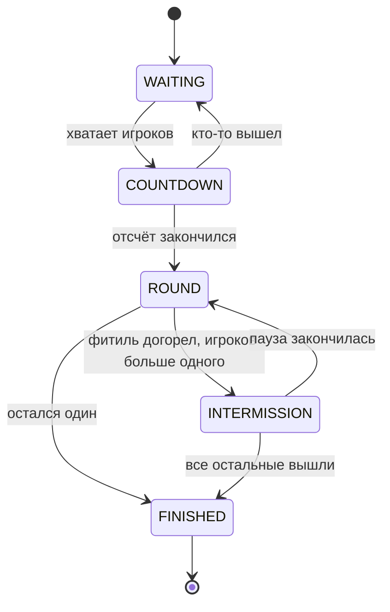

# HotPotato — «Горячая картошка»

[](https://github.com/TTcux1/HotPotato/actions/workflows/build.yml)

Мини-игра для серверов **Paper 1.21** на **Kotlin** со статистикой в **MongoDB**.

У нескольких игроков в руках горячая картошка с горящим фитилём. Ударь другого игрока, чтобы передать её. Когда фитиль догорает, все, у кого осталась картошка, взрываются и выбывают. Последний выживший побеждает.

## Чем отличается от классики

| Механика | Зачем |
| --- | --- |
| **Несколько картошек сразу:** одна на каждых 4 живых игроков | На больших аренах нет скучных раундов, где 15 человек смотрят на одного |
| **Фитиль короче с каждым раундом:** 30 → 27 → 24… до 10 с | Игра сама ускоряется к финалу |
| **Запрет мгновенного возврата:** 2 секунды нельзя вернуть картошку тому, кто её дал | Нет бесконечного пинг-понга двух игроков |
| **Остывание:** полсекунды после получения картошку нельзя передать | Передача требует позиционирования, а не спама кликом |
| **Ускорение и подсветка держателя** | Держатель быстрее и виден сквозь стены: у него есть шанс догнать, у остальных — сбежать |
| **Клатч-передачи:** передача в последнюю секунду объявляется всем и идёт в статистику | Самые яркие моменты игры становятся достижением |

Все числа настраиваются в [`config.yml`](src/main/resources/config.yml).

## Как устроен код



```
src/main/kotlin/dev/hotpotato/
├── core/                      Игровая логика. Не зависит от Bukkit, покрыта тестами
│   ├── HotPotatoGame          машина состояний: фазы, раунды, передачи, взрывы
│   ├── GameRules              правила и формулы (длина фитиля, число картошек)
│   ├── GameEvent              события, которые ядро сообщает наружу
│   └── Stats                  статистика и интерфейс хранилища
└── plugin/                    Связка с Paper
    ├── GameSession            превращает события ядра в звуки, частицы, боссбар
    ├── SessionManager         арены, сессии, асинхронное сохранение статистики
    ├── GameListener           удар = передача; урон, голод, стройка запрещены
    ├── MongoStatsRepository   статистика в MongoDB
    └── HotPotatoCommand       команды игроков и админов
```

Ключевые решения:

- **Ядро как чистая машина состояний.** `HotPotatoGame` не знает о сервере: время двигается вызовом `tick()`, случайность передаётся снаружи. Поэтому целые игры проигрываются в юнит-тестах за миллисекунды и детерминированно.
- **События вместо прямых вызовов.** Ядро возвращает список `GameEvent`, а `GameSession` решает, как их показать. Логику можно менять, не трогая эффекты, и наоборот.
- **Атомарная статистика.** В MongoDB результаты пишутся через `$inc` с upsert: если несколько серверов сети одновременно допишут результаты одного игрока, ничего не потеряется. Запись идёт асинхронно и не тормозит тики.
- **Состояние игрока сохраняется.** Инвентарь, режим игры, эффекты и позиция восстанавливаются при выходе, поэтому игру можно ставить и на общий сервер.
- **Маленький jar.** Драйвер MongoDB и kotlin-stdlib Paper скачивает сам через `libraries` в plugin.yml.
- **Готов к облаку.** Адрес базы и режим выделенного сервера задаются переменными окружения, пароль приходит из секрета, а не из файла в образе.

## Статистика

Один документ на игрока в коллекции `player_stats`:

```json
{
  "_id": "069a79f4-44e9-4726-a5be-fca90e38aaf5",
  "name": "Notch",
  "nameLower": "notch",
  "games": 12,
  "wins": 3,
  "passes": 41,
  "clutchPasses": 2,
  "explosions": 9,
  "roundsSurvived": 27
}
```

Если MongoDB выключена в конфиге или недоступна, статистика хранится в памяти до перезапуска, и плагин продолжает работать.

## Быстрый старт в Docker

Сервер с плагином, готовой ареной и MongoDB одной командой:

```bash
cp .env.example .env
docker compose up --build
```

Подключайся к `localhost:25565` — игра начнётся, когда зайдут двое. Развёртывание в Kubernetes, образ в GitHub Container Registry и устройство манифестов описаны в [deploy/README.md](deploy/README.md).

## Установка на свой сервер и настройка арены

1. Положите jar в `plugins/` сервера Paper 1.21+ (Java 21).
2. При необходимости включите MongoDB в `plugins/HotPotato/config.yml`.
3. Создайте арену в игре:

```
/hp create main        — создать арену
/hp setlobby main      — встать в точку ожидания и выполнить
/hp addspawn main      — добавить точки появления (несколько раз)
/hp join main          — войти в игру
```

## Команды

| Команда | Что делает | Право |
| --- | --- | --- |
| `/hp join [арена]` | Войти в игру (без названия — первая готовая арена) | — |
| `/hp leave` | Выйти из игры | — |
| `/hp stats [ник]` | Статистика игрока | — |
| `/hp top` | Топ-10 по победам | — |
| `/hp start` | Запустить игру досрочно (от 2 игроков) | `hotpotato.admin` |
| `/hp create \| setlobby \| addspawn \| delete <арена>` | Настройка арен | `hotpotato.admin` |
| `/hp list` | Список арен | `hotpotato.admin` |

Алиасы: `/hotpotato`, `/hp`, `/potato`.

## Сборка и тесты

```bash
./gradlew build
```

Jar появится в `build/libs/`. Тесты ядра запускаются при сборке и в GitHub Actions на каждый push.

## Планы

- [x] Docker Compose и манифесты Kubernetes для запуска сервера с MongoDB
- [ ] Несколько комнат за прокси Velocity с распределением игроков
- [ ] Голограммы с топом игроков в лобби
- [ ] Косметика для победителей: эффекты взрыва, следы

## Лицензия

[MIT](LICENSE)
