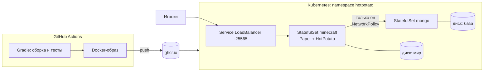

# Развёртывание

Один и тот же Docker-образ запускается локально через Docker Compose и в кластере через Kubernetes.



## Образ

[`Dockerfile`](../Dockerfile) собирает плагин внутри Docker (Java и Gradle на машине не нужны) и кладёт его в образ на основе [itzg/minecraft-server](https://github.com/itzg/docker-minecraft-server). В образ сразу входит готовая арена [`server/arenas.yml`](server/arenas.yml): плоский мир, лобби в центре и 8 точек появления по кругу.

Сервер работает в режиме выделенной мини-игры (`HOTPOTATO_AUTO_JOIN_ARENA=main`): игрок сразу попадает в игру, а после матча следующий начинается автоматически.

Настройки, которые меняются между окружениями, приходят из переменных окружения, а не из файлов в образе:

| Переменная | Что задаёт |
| --- | --- |
| `HOTPOTATO_MONGODB_URI` | Строка подключения к MongoDB. Если задана, база включается автоматически |
| `HOTPOTATO_MONGODB_DATABASE` | Имя базы, по умолчанию `hotpotato` |
| `HOTPOTATO_AUTO_JOIN_ARENA` | Арена для автовхода; пусто — обычный режим с `/hp join` |

## Локально: Docker Compose

```bash
cp .env.example .env          # задай пароль базы
docker compose up --build
```

Подключайся к `localhost:25565`. Первый запуск дольше: скачивается Paper и генерируется мир.

- Консоль сервера: `docker compose attach minecraft` (выйти — `Ctrl+P`, `Ctrl+Q`)
- Статистика в MongoDB Compass: `mongodb://hotpotato:<пароль>@localhost:27017/?authSource=admin`
- Остановить: `docker compose down` (данные сохранятся в томах)

## Кластер: Kubernetes

Манифесты лежат в [`k8s/`](k8s) и собираются через Kustomize, встроенный в `kubectl`.

1. Сделай push в `main`: GitHub Actions соберёт образ и опубликует его в `ghcr.io/<твой-ник>/hotpotato-server`. Чтобы кластер мог скачать образ без авторизации, сделай пакет публичным в настройках Packages на GitHub.
2. Если делаешь форк, замени в [`k8s/kustomization.yaml`](k8s/kustomization.yaml) `ttcux1` на свой ник.
3. Создай файл с паролем базы:

   ```bash
   cp deploy/k8s/mongo.env.example deploy/k8s/mongo.env
   ```

4. Разверни:

   ```bash
   kubectl apply -k deploy/k8s
   kubectl -n hotpotato get pods -w
   ```

5. Подключись. В облаке у сервиса `minecraft` появится внешний IP (`kubectl -n hotpotato get svc minecraft`). Локально (minikube, kind):

   ```bash
   kubectl -n hotpotato port-forward svc/minecraft 25565:25565
   ```

### Что в манифестах

| Объект | Зачем |
| --- | --- |
| `StatefulSet mongo` + headless `Service` | База с постоянным диском и стабильным именем `mongo-0.mongo` |
| `StatefulSet minecraft` | Сервер с постоянным диском под мир. При перезапуске под получает тот же диск |
| `initContainer wait-for-mongo` | Сервер не стартует, пока база не отвечает |
| `startupProbe` / `readinessProbe` / `livenessProbe` | Проверка через `mc-health`: до 5 минут на первый старт, потом трафик идёт только на готовый сервер, зависший сервер перезапускается |
| `Secret` из `mongo.env` (`secretGenerator`) | Пароль не хранится в git. При смене пароля поды перезапускаются автоматически: у секрета меняется хеш в имени |
| `NetworkPolicy` | К базе может подключиться только игровой сервер |
| `terminationGracePeriodSeconds: 60` | Сервер успевает сохранить мир при остановке |
| `securityContext` | Контейнеры работают не от root |

## Дальше

Следующий шаг масштабирования: несколько реплик `minecraft` за прокси Velocity, чтобы каждый под был отдельной комнатой, а игроки распределялись между ними. Headless-сервис `minecraft-headless` уже даёт подам стабильные DNS-имена для настройки прокси.
